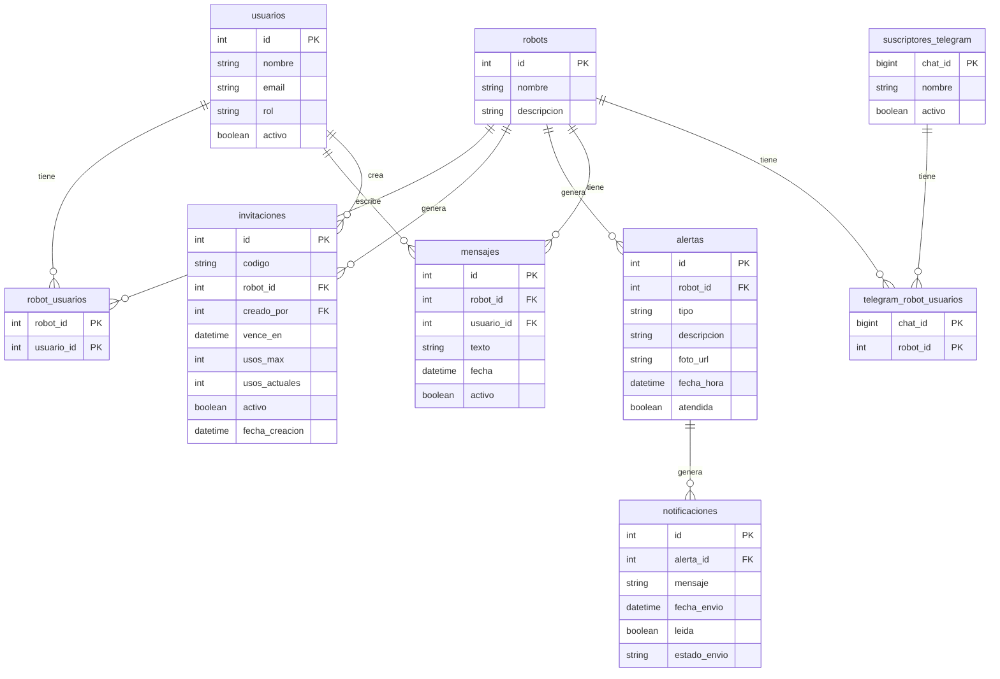
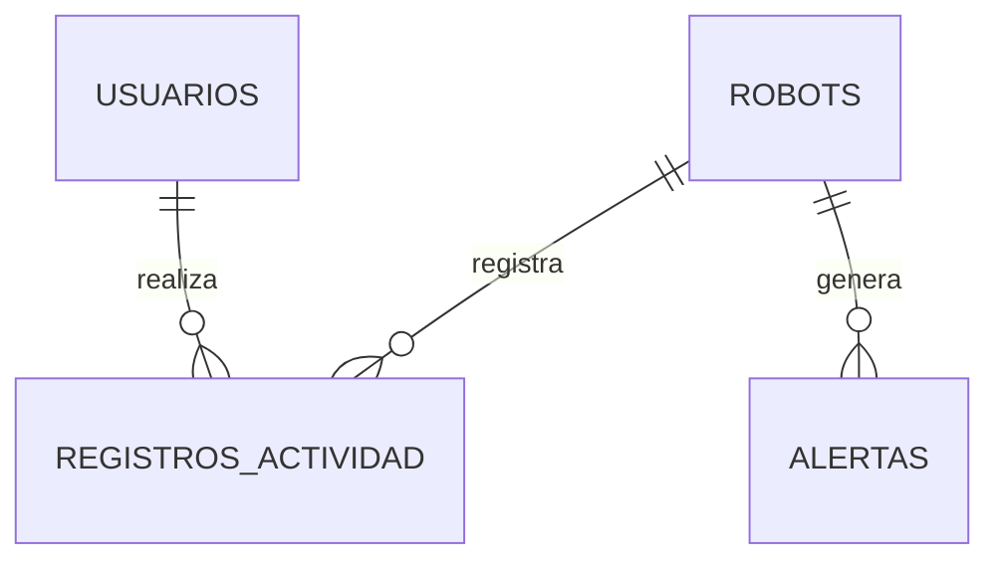

# PROTUD - Base de Datos

**Motor:** PostgreSQL en Render
**Proyecto:** PROTUD - Robot de Vigilancia

## Diagrama Entidad-Relación



## Explicación tabla por tabla

### 1. `usuarios`

Guarda a todas las personas que entraron con Google.

- `id`: número único
- `nombre`: nombre de Google
- `email`: único, no se puede repetir. Con esto se hace el login.
- `rol`: `administrador` o `operador`. El primero que entra queda como `operador`.
- `activo`: baja lógica. Si es `false`, no puede entrar aunque su Google sea válido. No se borra nunca.

### 2. `robots`

Cada robot de vigilancia.

- `id`: número único
- `nombre`: ejemplo Robot 1, Robot Patio
- `descripcion`: dónde está o qué vigila

### 3. `robot_usuarios`

Tabla puente muchos a muchos. Un usuario puede tener muchos robots. Un robot puede tener muchos usuarios.

- `robot_id` + `usuario_id` juntos son la clave.

### 4. `invitaciones`

Códigos para invitar.

- `codigo`: ejemplo `PROTUD-K7Q2`, único
- `robot_id`: a qué robot invita
- `creado_por`: id del admin que lo creó
- `vence_en`: vence a las 24 horas de creado
- `usos_max`: 5 usos
- `usos_actuales`: cuántas veces ya se usó
- `activo`: si el admin lo revocó, queda en `false` y ya no sirve
- `fecha_creacion`: cuándo se creó

### 5. `alertas`

Cuando el robot detecta algo.

- `robot_id`: qué robot la generó
- `tipo`: movimiento, obstáculo, etc.
- `descripcion`: texto de la alerta
- `foto_url`: link de la foto, si tiene
- `fecha_hora`: cuándo pasó
- `atendida`: `false` = pendiente, `true` = atendida

### 6. `notificaciones`

Una por cada alerta, para saber si se mandó.

- `alerta_id`: a qué alerta pertenece
- `mensaje`: texto que se mandó
- `fecha_envio`: cuándo se mandó
- `leida`: si alguien la leyó
- `estado_envio`: enviado, error, etc.

### 7. `mensajes`

Chat por robot.

- `robot_id`: en qué chat está
- `usuario_id`: quién lo escribió
- `texto`: mensaje
- `fecha`: cuándo lo mandó
- `activo`: si se borró, queda en `false`, no se borra de verdad

### 8. `suscriptores_telegram`

Gente que habló con el bot en Telegram.

- `chat_id`: id de Telegram, único
- `nombre`: nombre de Telegram
- `activo`: si sigue suscripto

### 9. `telegram_robot_usuarios`

Unión entre Telegram y robot. Dice qué chat de Telegram recibe alertas de qué robot.

- `chat_id` + `robot_id` juntos son la clave.

## Relaciones importantes

- Un usuario tiene muchos robots, y un robot tiene muchos usuarios.
- Un robot tiene muchas alertas, muchos mensajes, muchas invitaciones.
- Una alerta tiene muchas notificaciones.
- Un chat de Telegram puede estar unido a muchos robots.

## Bajas lógicas

No borramos nada. Usamos `activo = false` en:

- `usuarios`: no puede entrar
- `invitaciones`: código revocado
- `mensajes`: mensaje borrado pero queda guardado

## SQL completo para crear todo

```sql
CREATE TABLE IF NOT EXISTS usuarios (
  id SERIAL PRIMARY KEY,
  nombre VARCHAR(255),
  email VARCHAR(255) UNIQUE NOT NULL,
  rol VARCHAR(50) DEFAULT 'operador',
  activo BOOLEAN DEFAULT TRUE
);

CREATE TABLE IF NOT EXISTS robots (
  id SERIAL PRIMARY KEY,
  nombre VARCHAR(255),
  descripcion TEXT
);

CREATE TABLE IF NOT EXISTS robot_usuarios (
  robot_id INTEGER NOT NULL,
  usuario_id INTEGER NOT NULL,
  PRIMARY KEY (robot_id, usuario_id)
);

CREATE TABLE IF NOT EXISTS invitaciones (
  id SERIAL PRIMARY KEY,
  codigo VARCHAR(50) UNIQUE NOT NULL,
  robot_id INTEGER NOT NULL,
  creado_por INTEGER NOT NULL,
  vence_en TIMESTAMP,
  usos_max INTEGER DEFAULT 5,
  usos_actuales INTEGER DEFAULT 0,
  activo BOOLEAN DEFAULT TRUE,
  fecha_creacion TIMESTAMP DEFAULT NOW()
);

CREATE TABLE IF NOT EXISTS alertas (
  id SERIAL PRIMARY KEY,
  robot_id INTEGER NOT NULL,
  tipo VARCHAR(100),
  descripcion TEXT,
  foto_url TEXT,
  fecha_hora TIMESTAMP DEFAULT NOW(),
  atendida BOOLEAN DEFAULT FALSE
);

CREATE TABLE IF NOT EXISTS notificaciones (
  id SERIAL PRIMARY KEY,
  alerta_id INTEGER NOT NULL,
  mensaje TEXT,
  fecha_envio TIMESTAMP DEFAULT NOW(),
  leida BOOLEAN DEFAULT FALSE,
  estado_envio VARCHAR(50)
);

CREATE TABLE IF NOT EXISTS mensajes (
  id SERIAL PRIMARY KEY,
  robot_id INTEGER NOT NULL,
  usuario_id INTEGER NOT NULL,
  texto TEXT NOT NULL,
  fecha TIMESTAMP DEFAULT NOW(),
  activo BOOLEAN DEFAULT TRUE
);

CREATE TABLE IF NOT EXISTS suscriptores_telegram (
  chat_id BIGINT PRIMARY KEY,
  nombre VARCHAR(255),
  activo BOOLEAN DEFAULT TRUE
);

CREATE TABLE IF NOT EXISTS telegram_robot_usuarios (
  chat_id BIGINT NOT NULL,
  robot_id INTEGER NOT NULL,
  PRIMARY KEY (chat_id, robot_id)
);
```


