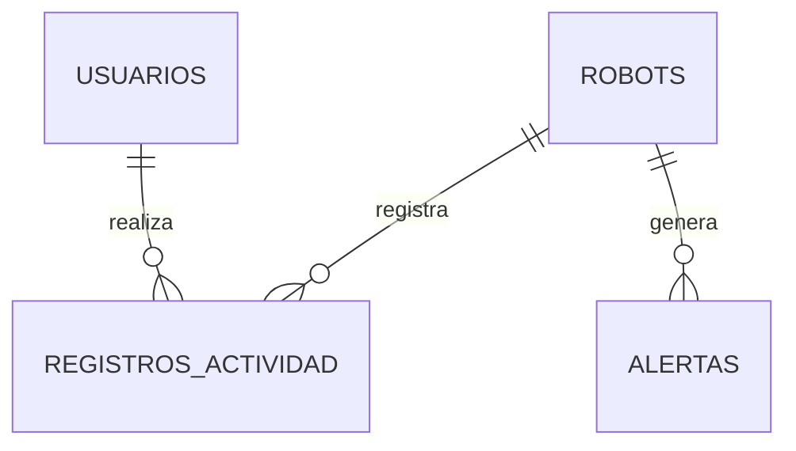

# Diseño de la base de datos de protud.

## 1. Introducción

La base de datos de PROTUD permitirá almacenar y administrar
la información necesaria para el funcionamiento del sistema
de vigilancia robótica.

El sistema contará con una aplicación web desarrollada
en Python, desde la cual los usuarios podrán iniciar sesión,
controlar el robot y consultar las alertas de seguridad.

Para almacenar la información se propone utilizar PostgreSQL,
una base de datos relacional.

## 2. Tablas de la base de datos

### Tabla: usuarios

Almacena la información de las personas autorizadas
a utilizar la aplicación web de PROTUD.

| Campo | Tipo | Descripción |
|-------|------|-------------|
| id | INTEGER | Identificador único del usuario |
| nombre | VARCHAR(100) | Nombre del usuario |
| email | VARCHAR(150) | Correo electrónico |
| password_hash | VARCHAR(255) | Contraseña protegida mediante hash |
| rol | VARCHAR(20) | Administrador u operador |
| activo | BOOLEAN | Indica si el usuario está habilitado |
| fecha_registro | TIMESTAMP | Fecha de creación de la cuenta |

Clave primaria: id

El correo electrónico deberá ser único.

Las contraseñas nunca se almacenarán en texto plano.

### Tabla: robots

Almacena la información de los robots PROTUD
registrados en el sistema.

| Campo | Tipo | Descripción |
|-------|------|-------------|
| id | INTEGER | Identificador único del robot |
| nombre | VARCHAR(100) | Nombre del robot |
| ubicacion | VARCHAR(150) | Lugar donde opera |
| estado | VARCHAR(30) | Activo, inactivo o desconectado |
| fecha_registro | TIMESTAMP | Fecha de registro |

Clave primaria: id

### Tabla: alertas

Registra los eventos de seguridad detectados
por los robots PROTUD.

| Campo | Tipo | Descripción |
|-------|------|-------------|
| id | INTEGER | Identificador único de la alerta |
| robot_id | INTEGER | Robot que generó la alerta |
| tipo | VARCHAR(50) | Tipo de alerta |
| descripcion | TEXT | Información del evento |
| fecha_hora | TIMESTAMP | Momento de la detección |
| atendida | BOOLEAN | Indica si fue revisada |

Clave primaria: id

Clave foránea: robot_id, relacionada con robots.id

### Tabla: registros_actividad

Almacena las acciones realizadas por los usuarios
desde el panel de control de PROTUD.

| Campo | Tipo | Descripción |
|-------|------|-------------|
| id | INTEGER | Identificador del registro |
| usuario_id | INTEGER | Usuario que realizó la acción |
| robot_id | INTEGER | Robot involucrado |
| accion | VARCHAR(100) | Acción realizada |
| fecha_hora | TIMESTAMP | Fecha y hora de la acción |

Clave primaria: id

Claves foráneas:
- usuario_id, relacionada con usuarios.id
- robot_id, relacionada con robots.id

## 3. Relaciones entre las tablas

La base de datos utiliza relaciones para conectar
la información de usuarios, robots y eventos.

Relación 1:
Un robot puede generar múltiples alertas.
Cada alerta pertenece a un robot.

Relación 2:
Un usuario puede realizar múltiples acciones.
Cada registro de actividad pertenece a un usuario.

Relación 3:
Un robot puede tener múltiples registros de actividad.
Cada registro de actividad corresponde a un robot.

## 4. Diagrama de relaciones

El siguiente diagrama representa las relaciones
entre las tablas principales de PROTUD.

