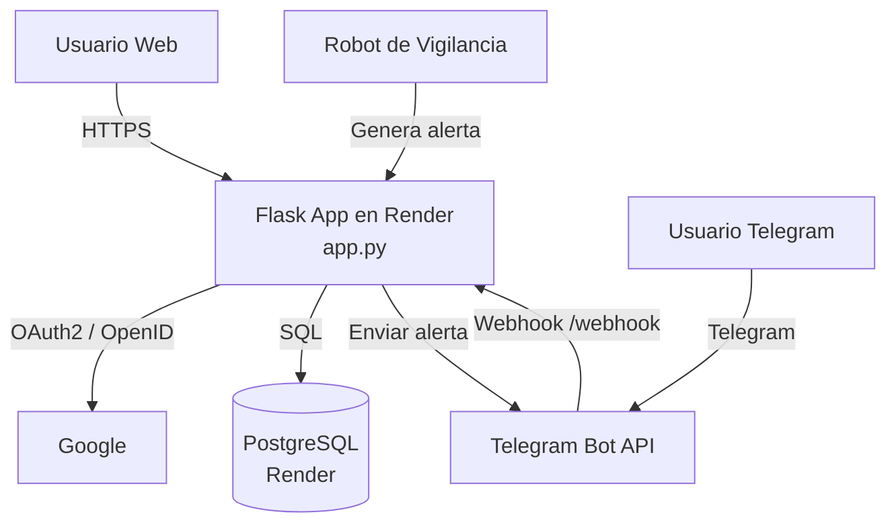
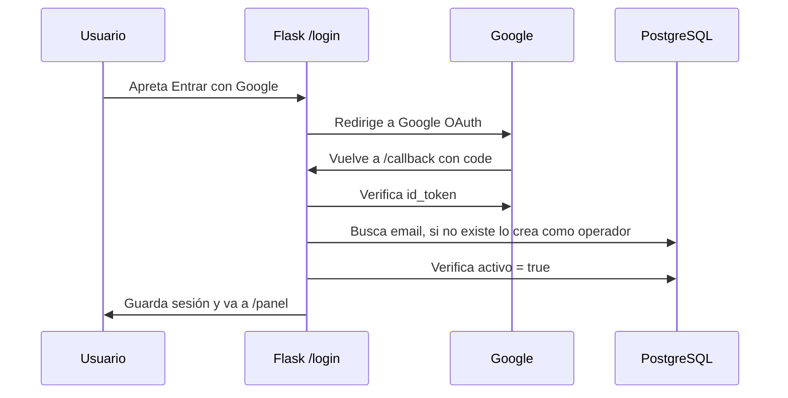
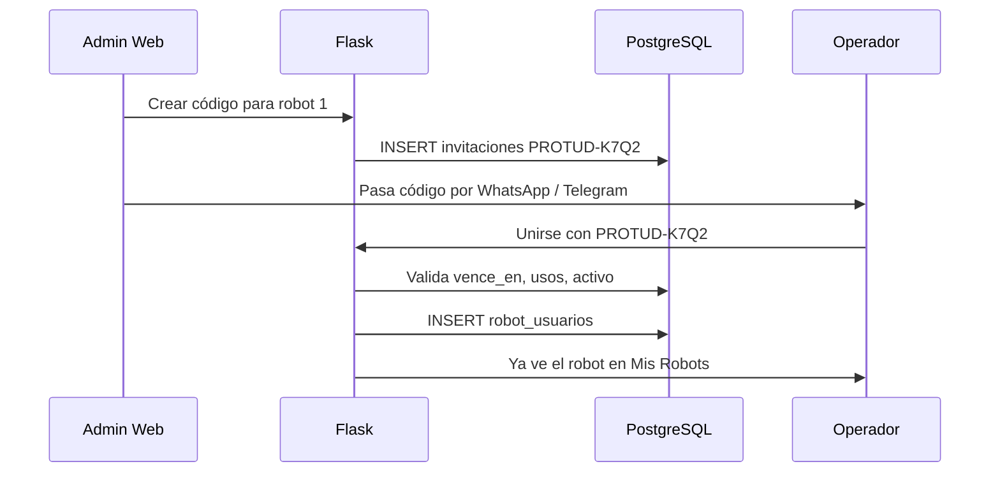
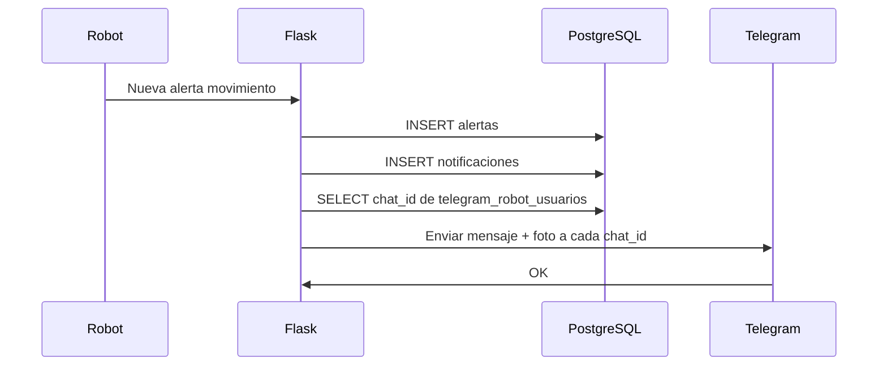
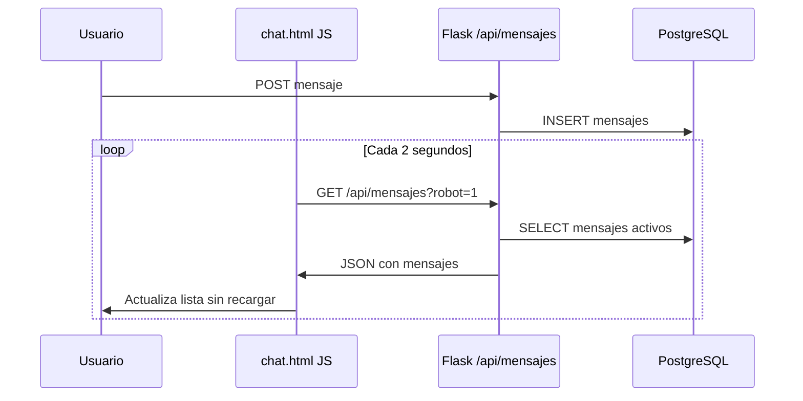

# PROTUD - Arquitectura del Sistema

**Proyecto:** PROTUD - Robot de Vigilancia
**Profesor:** Leonardo Baldelli
**Integrantes:** Ariel Alfonso - Equipo Protud
**Stack:** Python + Flask + PostgreSQL + Google OAuth2 / OpenID + Telegram Bot API + Render

---

## 1. Vista general

PROTUD es una aplicación web monolítica en Flask, desplegada en Render, con base de datos PostgreSQL y un bot de Telegram integrado por webhook.

El usuario entra con Google, ve sus robots, chatea, ve alertas y recibe notificaciones por Telegram.

---

## 2. Componentes

### 2.1 Frontend - Templates Jinja2

Carpeta `templates/`:

- `index.html`: página principal / login
- `panel.html`: panel con alertas pendientes, últimas 24hs y últimas 5
- `mis_robots.html`: lista de robots, crear código, unirse con código
- `chat.html`: chat por robot, polling cada 2 segundos con JavaScript
- `alertas.html`: alertas pendientes y atendidas
- `usuarios.html`: gestión de usuarios, solo admin
- `base.html`: plantilla base con menú y estilos

Carpeta `static/`:

- `logo.jpg`, `robot.jpg`

No hay framework JS. Se usa HTML + CSS + JavaScript puro con `fetch()` para el chat.

### 2.2 Backend - Flask `app.py`

Archivo principal `app.py`. Ahí está todo:

**Autenticación:**

- `login()`: redirige a Google
- `callback()`: verifica `id_token` con `google.oauth2.id_token.verify_oauth2_token`, crea usuario si no existe, guarda sesión
- `logout()`: limpia sesión
- `login_required`: decorador que obliga a estar logueado
- `admin_required`: decorador que obliga a ser administrador
- `usuario_puede_ver_robot()`: verifica acceso a un robot

**Rutas principales:**

- `/`: inicio / login
- `/panel`: panel de alertas
- `/mis-robots`: ver robots, crear código, unirse con código
- `/chat?robot=1`: chat por robot
- `/api/mensajes?robot=1`: API JSON para polling del chat
- `/alertas`: ver alertas, atender / deshacer
- `/usuarios`: gestión de usuarios (solo admin)
- `/simular-alerta`: crear alerta de prueba (solo admin)
- `/probar-telegram`: probar envío a Telegram (solo admin)
- `/webhook`: recibe mensajes de Telegram

**Lógica de negocio:**

- `crear_invitacion()`: genera código `PROTUD-XXXX`, dura 24hs, 5 usos
- `unirse_con_codigo()`: valida código, vence, usos, activo, y une usuario a robot
- `atender_alerta()`: marca `atendida = true`

### 2.3 Servicio Telegram `telegram_service.py`

Funciones:

- `enviar_alerta_telegram(robot_id, alerta)`: busca todos los `chat_id` suscriptos a ese robot en `telegram_robot_usuarios` y les manda el mensaje con foto
- `enviar_mensaje(chat_id, texto)`: manda mensaje simple con `requests` a `api.telegram.org`

Webhook en `app.py`:

- Recibe `/start`, `/unirme PROTUD-XXXX`, `/mis_espacios`, `/ayuda`
- Guarda en `suscriptores_telegram` y en `telegram_robot_usuarios`

### 2.4 Base de datos PostgreSQL

Base en Render. 9 tablas:

- `usuarios`: id, nombre, email, rol, activo
- `robots`: id, nombre, descripcion
- `robot_usuarios`: robot_id, usuario_id (muchos a muchos)
- `invitaciones`: codigo, robot_id, creado_por, vence_en, usos_max, usos_actuales, activo
- `alertas`: robot_id, tipo, descripcion, foto_url, fecha_hora, atendida
- `notificaciones`: alerta_id, mensaje, fecha_envio, leida, estado_envio
- `mensajes`: robot_id, usuario_id, texto, fecha, activo
- `suscriptores_telegram`: chat_id, nombre, activo
- `telegram_robot_usuarios`: chat_id, robot_id

Diagrama completo en `docs/database-schemas.md`.

### 2.5 Servicios externos

- **Google OAuth2 / OpenID Connect:** login, sin contraseña propia
- **Telegram Bot API:** notificaciones y comandos
- **Render:** hosting web + hosting PostgreSQL
- **GitLab:** repositorio y deploy automático

---

## 3. Flujos principales

### 3.1 Login con Google

### 3.2 Crear código y unirse

### 3.3 Alerta del robot a Telegram

### 3.4 Chat en vivo

---

## 4. Seguridad

- Login solo con Google, no hay contraseñas guardadas
- `SECRET_KEY` en variables de entorno, no en código
- Sesión con cookie HttpOnly, `Secure=true` en Render
- `login_required` en todas las rutas privadas
- `admin_required` en `/usuarios`, `/simular-alerta`, `/probar-telegram`, crear código
- `usuario_puede_ver_robot()` en `/chat` y `/api/mensajes` para que un usuario no vea el chat de un robot al que no pertenece
- Operador solo puede borrar sus mensajes, admin puede borrar cualquiera
- Baja lógica: `activo = false` no borra, pero bloquea login y escritura
- Códigos de invitación con vencimiento 24hs y máximo 5 usos, se pueden revocar
- Variables sensibles solo en `.env` / Render, nunca en GitLab

---

## 5. Deploy y entornos

| Entorno | URL | Base | SESSION_COOKIE_SECURE |
|---|---|---|---|
| Local | http://127.0.0.1:5000 | PostgreSQL Render o local | false |
| Producción | https://tu-app.onrender.com | PostgreSQL Render | true |

**Render Web Service:**

- Build: `pip install -r requirements.txt`
- Start: `gunicorn app:app --workers 1 --bind 0.0.0.0:$PORT`

**Variables en Render:**
`SECRET_KEY`, `GOOGLE_CLIENT_ID`, `GOOGLE_CLIENT_SECRET`, `DATABASE_URL`, `TELEGRAM_BOT_TOKEN`, `SESSION_COOKIE_SECURE=true`

---

## 6. Limitaciones y mejoras futuras

- El chat usa polling cada 2 segundos, no WebSocket. Para escalar se podría usar Socket.IO.
- El robot todavía no manda alertas reales, se simula con `/simular-alerta`. Falta conectar ESP32 / Raspberry por MQTT o HTTP.
- No hay tests automáticos. Se prueba manual con checklist en `docs/manual/uso.md`.
- Un solo worker en gunicorn para evitar duplicar webhooks de Telegram.
